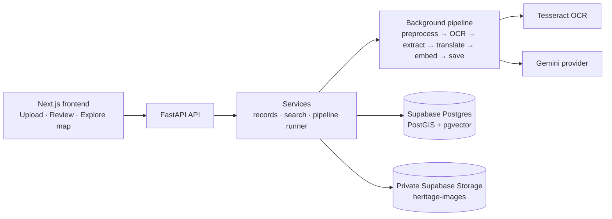
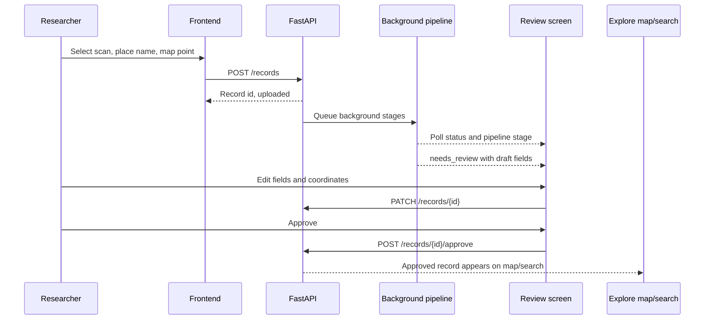

# Heritage Atlas

Heritage Atlas helps turn field evidence into a place-aware, reviewable heritage record. A student may photograph Adalaj stepwell and write Gujarati/Hindi notes, but the material can end up scattered across slide decks and cloud folders, leaving a researcher unable to search for “stepwells with carved pillars”. This prototype keeps the image, location, OCR text, translations, structured suggestions, citations, and review decision together so approved records can be found on a map and by meaning.

## Features

- Upload one JPEG, PNG, or WebP image (maximum 8 MB), a place name, and a map coordinate.
- Store source images in a private Supabase Storage bucket.
- Run a background pipeline: preprocessing, Tesseract OCR (`eng+hin+guj`), Gemini extraction, translation, embedding, and save.
- Persist checkpoints and show the current stage; failed records can retry from their saved stage.
- Reviewers can edit extracted title, type, period, materials, features, language, text, summary, place, region, and coordinates before approval.
- Keep records in `needs_review` until a human approves them; the pipeline never auto-approves.
- Show approved records as GeoJSON map pins and support bounding-box/type filtering.
- Search approved records with semantic similarity plus a short lexical explanation, with optional type filtering.
- Generate five-minute signed image URLs without making the bucket public.
- Run deterministic fake-provider unit tests without Gemini calls.

## Architecture

## Data model and indexes

`heritage_records` stores UUID, timestamps, title, `monument_type` (`stepwell`, `fort`, `temple`, `mosque`, `craft`, `other`), period, materials, features, language, original/English text, summary, private image path, citation URL/title, verification notes, place/region, PostGIS `geography(Point,4326)` location, workflow status, pipeline stage, error/warning, OCR confidence, and a 768-dimensional embedding. Migration `002_record_citations.sql` adds the citation fields for databases that already ran migration 001.

- **GiST on `location`** accelerates spatial predicates and map bounding-box filters.
- **HNSW on `embedding`** accelerates approximate nearest-neighbor cosine searches.
- **B-tree on `status`** accelerates review/approval workflow filters.
- **B-tree on `monument_type`** accelerates exact Explore type filters.

## Local setup

1. Create a Supabase project with PostGIS and pgvector available.
2. Apply `supabase/migrations/001_init.sql`, then `supabase/migrations/002_record_citations.sql` in the Supabase SQL editor.
3. In Storage, create a **private** bucket named `heritage-images`.
4. From the repository root, copy `.env.example` to `.env` and fill in `SUPABASE_URL`, `SUPABASE_SERVICE_KEY`, and `GEMINI_API_KEY`. Keep server-only keys out of frontend variables.
5. Install backend dependencies: `python3 -m pip install -r requirements.txt`. On Linux, install Tesseract plus English, Hindi, and Gujarati language data if they are not already installed.
6. Run the backend: `PYTHONPATH=backend uvicorn app.main:app --reload --app-dir backend`.
7. In `frontend/`, copy `.env.example` to `.env.local`, confirm `NEXT_PUBLIC_API_URL=http://127.0.0.1:8000`, then run `pnpm install --frozen-lockfile` and `pnpm dev`.
8. Review the seed manifest without external calls: `python3 scripts/seed_demo_records.py`.
9. After independently confirming the intended free-tier services, configuring the server variables, and applying both migrations, use `python3 scripts/seed_demo_records.py --apply`. It makes real Gemini/Supabase requests, upserts five rows, and does not upload images; the listed seed image paths remain placeholders until authorized files are added to private Storage.

## Environment variables

| Variable | Used by | Purpose |
|---|---|---|
| `SUPABASE_URL` | backend/seed | Supabase project URL |
| `SUPABASE_SERVICE_KEY` | backend/seed | Server-side Supabase service key |
| `GEMINI_API_KEY` | backend/seed | Gemini Developer API key |
| `GEMINI_MODEL` | backend | Configured generation model identifier |
| `EMBEDDING_MODEL` | backend | Configured embedding model identifier |
| `EMBEDDING_DIM` | backend | Must match the 768-vector schema |
| `AI_PROVIDER` | backend | `gemini` in real runs; tests inject `fake` directly |
| `SEARCH_MIN_SIMILARITY` | backend | Minimum semantic result score |
| `CORS_ORIGINS` | backend | Comma-separated allowed browser origins |
| `NEXT_PUBLIC_API_URL` | frontend | Browser base URL for FastAPI |
| `NEXT_PUBLIC_OSM_TILE_URL` | frontend | OpenStreetMap tile template |

## API endpoints

| Method | Endpoint | Purpose |
|---|---|---|
| GET | `/health` | Liveness check |
| POST | `/records` | Validate and upload an image; starts background processing |
| GET | `/records/{id}` | Read a record and its workflow status |
| GET | `/records/{id}/image` | Create a five-minute signed source-image URL |
| PATCH | `/records/{id}` | Edit reviewable metadata |
| POST | `/records/{id}/approve` | Approve a record currently in `needs_review` |
| POST | `/records/{id}/retry` | Retry a failed record from its saved stage |
| GET | `/records` | GeoJSON approved records; supports `bbox` and `type` |
| GET | `/search?q=...` | Semantic search over approved records; supports `limit` and `type` |

## Scale plan

At **10×**, replace process-local background tasks with a durable task queue such as Celery/Redis, add separate OCR/AI workers, enforce concurrency and retry limits, cache repeated query embeddings, and add structured monitoring. At **100×**, partition worker pools by stage, use a CDN or image transformation layer for approved public assets while retaining private originals, add database read replicas/caching and tuned vector/spatial indexes, and support controlled batch imports with idempotent manifests and rate-limit backoff.

## Honest limitations

OCR is weakest on handwriting, damaged pages, mixed scripts, and old scripts. Free-tier AI quotas and model availability can change. The LLM can hallucinate, so human review is required and approval is explicit. The seed set is small, and the seed image paths are placeholders rather than downloaded source photos. This prototype has no 3D, authentication, or payments. Background work is process-local; a stopped API can interrupt it. Map pins may be approximate, and approved coordinates can reveal sensitive locations. The contact form is browser-only and does not send messages.

## Roadmap

1. Durable queue and observable worker execution.
2. Better OCR confidence review, provenance capture, and field-level citations.
3. Collection import/export with deduplication and batch validation.
4. Configurable retention/deletion workflows and stronger sensitive-location controls.
5. More languages and evaluation sets for OCR, translation, and search quality.
6. Optional 3D and richer media only after the core record workflow is reliable.

## Related work

Gyan Bharatam is a national manuscript portal; MIDF and India Lost & Found address different combinations of heritage imagery, documentation, and discovery; Tirtha (NISER) demonstrates a scholarly heritage-information direction. These efforts focus on formal manuscripts, established collections, or photos and maps. Heritage Atlas explores the gap where student field documentation sits between them: a local-language image or note that needs structure, a place, citations, and a human review step. It does not claim to be the first system in this space.

## Credits and licences

The landing-page Adalaj photograph is credited on `/credits` to AnupGandhe via Wikimedia Commons under CC BY-SA 4.0. Map tiles are provided by OpenStreetMap contributors under the ODbL, with attribution in the map. Seed records include source URLs and uncertainty notes. Keep the image attribution on `/credits` when redistributing the project.
