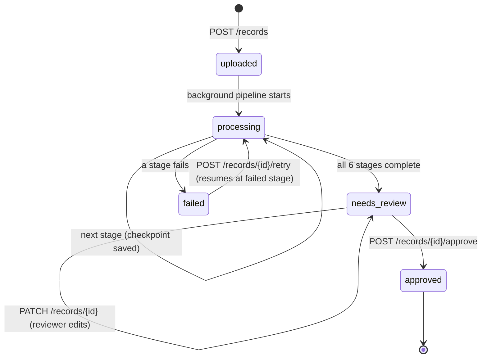
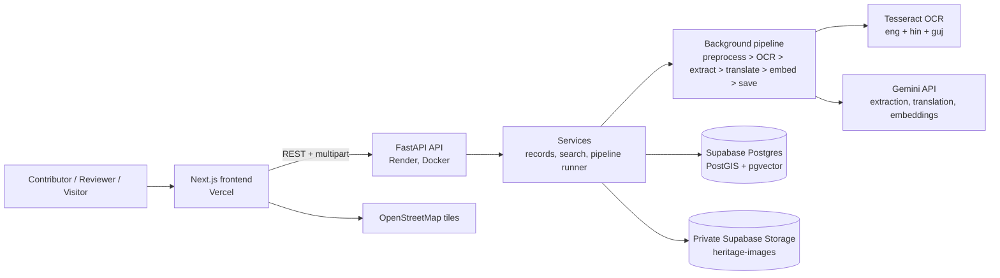
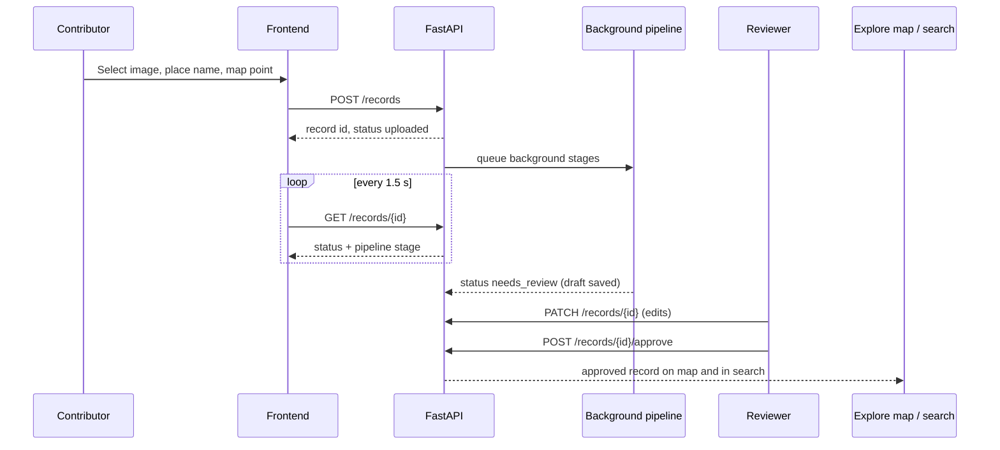
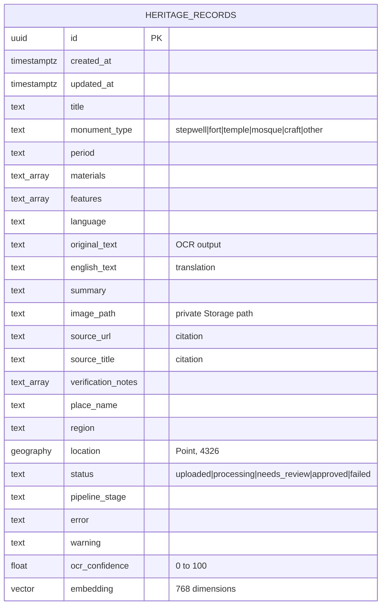

<div align="center">

# Heritage Atlas

**From field photo to a searchable, human-reviewed heritage archive.**

AI suggests. People decide.


</div>

---

## Table of contents

1. [The problem](#1-the-problem)
2. [The solution](#2-the-solution)
3. [Features](#3-features)
4. [How it works](#4-how-it-works)
5. [Architecture](#5-architecture)
6. [Data model](#6-data-model)
7. [API reference](#7-api-reference)
8. [Tech stack, libraries and APIs](#8-tech-stack-libraries-and-apis)
9. [Setup and installation](#9-setup-and-installation)
10. [Environment variables](#10-environment-variables)
11. [Seed data](#11-seed-data)
12. [Testing and CI](#12-testing-and-ci)
13. [Deployment](#13-deployment)
14. [Project structure](#14-project-structure)
15. [Design decisions](#15-design-decisions)
16. [Scalability plan](#16-scalability-plan)
17. [Limitations](#17-limitations)
18. [Roadmap](#18-roadmap)
19. [Trust, privacy and responsible AI](#19-trust-privacy-and-responsible-ai)
20. [Related work](#20-related-work)
21. [Team](#21-team)
22. [Credits and licences](#22-credits-and-licences)

---

## 1. The problem

Cultural heritage is documented in fragments. A student photographs the Adalaj stepwell and writes notes in Gujarati or Hindi, but the photo ends up on a phone, the location in someone's memory, the notes in a slide deck, and the translation nowhere. When these pieces are separated:

| Pain point | Consequence |
|---|---|
| **Fragmented capture** | Images, notes, coordinates and descriptions live on different devices and files. |
| **Unstructured records** | A photo alone has no consistent title, type, period or searchable metadata. |
| **Location ambiguity** | Without reliable coordinates a site cannot be placed on a map. |
| **Language barriers** | Source text in Gujarati, Hindi or English limits who can find and read it. |
| **Weak discovery** | Keyword search cannot find "stepwells with carved pillars" if the record says "five-storey vav with sculpted columns". |
| **Verification risk** | AI-written history can sound confident while being wrong. Publishing it unreviewed damages the archive itself. |

> **How might we make heritage documentation easy to capture and easy to find, without letting AI suggestions become unverified historical claims?**

## 2. The solution

Heritage Atlas is a **field-to-archive workspace**. A contributor uploads one image and marks the place on a map. A background pipeline turns it into a structured, multilingual, searchable **draft**. A human reviewer corrects it and explicitly approves it. Only then does it appear on the public map and in search.

```
Photo + map pin  >  Preprocess  >  OCR  >  Extract  >  Translate  >  Embed  >  Save
                                                                                |
                    Public map + semantic search  <  Human approval  <  needs_review
```

The central design rule: **the pipeline never auto-approves.** Every record stops at `needs_review`.

## 3. Features

**Capture**
- Upload one JPEG, PNG or WebP image (max 8 MB) with a place name and a map coordinate chosen on an interactive Leaflet map.
- Source images are stored in a **private** Supabase Storage bucket.

**Processing**
- Six-stage background pipeline: preprocessing (OpenCV), OCR (Tesseract, `eng+hin+guj`), AI extraction (Gemini), translation, embedding, save.
- Every stage persists a **checkpoint**. A failed record can be retried and resumes from the failed stage instead of starting over.
- Live progress stepper in the UI, driven by polling the record every 1.5 seconds.

**Review**
- Reviewers can edit title, type, period, materials, features, language, original and English text, summary, place, region and coordinates before approval.
- Extraction output is validated against a strict Pydantic schema. Invalid output is corrected once, then degraded to a clearly flagged "needs manual review" draft.

**Discovery**
- Approved records appear as GeoJSON pins on an Explore map, with bounding-box and monument-type filtering.
- Semantic search over approved records using vector similarity, plus a short lexical "why this matched" explanation.
- Detail panel shows the cited source and any unresolved notes.
- Source images are served through five-minute signed URLs, never a public bucket.

**Quality**
- Deterministic fake AI provider for offline unit tests (24 backend tests).
- GitHub Actions CI for backend lint and tests, and frontend lint, typecheck and build.

## 4. How it works

### Record lifecycle



### The six pipeline stages

| # | Stage | What it does | Output | If it fails |
|---|---|---|---|---|
| 1 | **Preprocess** | Resize to max 2000 px, grayscale, denoise, Otsu-based deskew, adaptive threshold (OpenCV). Original bytes are kept. | Cleaned image for OCR | Record fails at `preprocess` |
| 2 | **OCR** | Tesseract with `eng+hin+guj`. Computes mean word confidence. Fewer than 20 characters is non-fatal. | `original_text`, `ocr_confidence` | Fails at `ocr`; little or no text continues using image-aware extraction |
| 3 | **Extract** | Gemini reads the OCR text, place name and the image, and returns JSON constrained to a schema. Temperature 0.1. | Title, type, period, materials, features, language, summary, confidence | Provider error fails at `extract`; invalid JSON is corrected once, then flagged for manual review |
| 4 | **Translate** | Translates non-English text to English, preserving names and uncertainty. English text is copied unchanged. | `english_text` | Fails at `translate`; earlier checkpoints stay saved |
| 5 | **Embed** | Builds a search document (max 2,000 chars) from the fields and generates a 768-dimension vector. Dimension is checked. | `embedding` | Fails at `embed`; retry resumes here |
| 6 | **Save** | Persists everything and sets status to `needs_review`. Never approves. | Review-ready record | Fails at `save` |

### Checkpoint and retry

`pipeline_runner.run_pipeline` marks the record `processing` and records the current stage before running it, then writes that stage's outputs to the database. On failure the record becomes `failed` with the stage and a readable message. `POST /records/{id}/retry` rebuilds the pipeline context from the saved row and resumes at the stored stage, so a temporary AI outage during Extract does not repeat preprocessing or OCR.

The Gemini adapter itself retries transient `429` and `5xx` responses up to two times with exponential backoff (0.5 s, then 1 s), and spaces API calls by 0.5 s to reduce free-tier bursts.

### Extraction prompt

The extraction prompt (`backend/app/providers/prompts.py`) instructs the model to act as a careful archivist, infer cautiously, never invent unsupported facts, use `"unknown"` for uncertain periods, use `null` or empty arrays for unsupported fields, and limit the summary to 60 words. It includes two few-shot examples (a Gujarati stepwell note and an English fort note) and states that `confidence` reflects evidence quality, not model certainty.

## 5. Architecture

### System overview



### End-to-end sequence



### Backend layering

| Layer | Folder | Responsibility |
|---|---|---|
| Routers | `backend/app/routers/` | HTTP validation and response mapping only |
| Services | `backend/app/services/` | Upload orchestration, pipeline runner, search |
| Pipeline | `backend/app/pipeline/` | One isolated function per stage, sharing a `PipelineContext` |
| Providers | `backend/app/providers/` | Replaceable interfaces for AI (`AIProvider`), OCR (`OCRProvider`) and storage (`ImageStorage`) |
| DB | `backend/app/db/` | All database queries |
| Models | `backend/app/models/` | Pydantic schemas |
| Core | `backend/app/core/` | Settings from environment |

External calls sit behind interfaces so the pipeline can run offline with the fake provider, and a different AI, OCR or storage provider can be swapped in without touching routes.

### Frontend boundaries

- `frontend/src/lib/api.ts` owns all browser-to-API requests; `frontend/src/types/api.ts` validates every response with **Zod**, so schema drift becomes a friendly error rather than a runtime crash.
- `usePolling` uses a cleanup-safe recursive timeout (not `setInterval`) so slow requests cannot overlap, and aborts in-flight requests on unmount.
- The Leaflet map is dynamically imported with `ssr: false` because it needs browser layout APIs.

## 6. Data model

Heritage Atlas uses **one core table**, `public.heritage_records`, plus a private Storage bucket.



**Indexes**

| Index | Type | Purpose |
|---|---|---|
| `location` | GiST | Spatial predicates and map bounding-box filters |
| `embedding` | HNSW (`vector_cosine_ops`) | Approximate nearest-neighbour semantic search |
| `status` | B-tree | Review and approval workflow filters |
| `monument_type` | B-tree | Explore type filter |

**Database objects**
- `set_heritage_records_updated_at()` trigger keeps `updated_at` current.
- `match_records(query_embedding vector(768), match_count int)` returns approved records ordered by cosine distance, with `similarity = 1 - distance`. Only `status = 'approved'` rows with an embedding are searchable.
- Check constraints enforce valid `monument_type`, `status` and `ocr_confidence`.

**Storage:** a private bucket named `heritage-images`. The database stores the object path, never the image bytes.

**Migrations** (`supabase/migrations/`)
- `001_init.sql`: extensions (`postgis`, `vector`, `pgcrypto`), table, trigger, indexes, `match_records`.
- `002_record_citations.sql`: adds `source_url`, `source_title`, `verification_notes` for databases that already ran 001. Both migrations are safe to re-run.

## 7. API reference

Base URL locally: `http://127.0.0.1:8000`. Interactive docs at `/docs` (FastAPI Swagger UI).

| Method | Endpoint | Purpose |
|---|---|---|
| `GET` | `/health` | Liveness check |
| `POST` | `/records` | Multipart upload (`image`, `place_name`, `lat`, `lng`). Validates type and size, stores the image, starts the pipeline. Returns `201` with id and status |
| `GET` | `/records/{id}` | Read a record and its workflow status |
| `GET` | `/records/{id}/image` | Five-minute signed URL for the private source image |
| `PATCH` | `/records/{id}` | Edit reviewable metadata |
| `POST` | `/records/{id}/approve` | Approve a record currently in `needs_review` (otherwise `409`) |
| `POST` | `/records/{id}/retry` | Resume a `failed` record at its saved stage (`202`; otherwise `409`) |
| `GET` | `/records` | Approved records as a GeoJSON `FeatureCollection`. Supports `bbox=west,south,east,north` and `type` |
| `GET` | `/search?q=...` | Semantic search over approved records. Supports `limit` (1 to 50) and `type` |

**Validation and errors**
- Upload accepts `image/jpeg`, `image/png`, `image/webp` only (`415` otherwise) and at most 8 MB (`413`); empty files return `400`.
- `lat` must be in [-90, 90] and `lng` in [-180, 180].
- All errors use one stable envelope: `{"error": {"code": "...", "message": "..."}}`. Unexpected failures return a non-sensitive `internal_error`.
- Search results carry `similarity` and `why_matched`, for example `type: stepwell; features: carved pillars; shared keywords`.

**Semantic search details:** the query is embedded (with an LRU cache of 100 queries), the top 100 approved candidates are fetched by cosine similarity, results below `SEARCH_MIN_SIMILARITY` (default 0.35) are dropped, and the rest are sorted by similarity.

## 8. Tech stack, libraries and APIs

### Frontend (`frontend/`)

| Technology | Version | Use |
|---|---|---|
| Next.js (App Router) | 16.4.3 | Framework, routing |
| React | 19.3.1 | UI |
| TypeScript | 5.9.3 | Type safety |
| Tailwind CSS | 3.4.19 | Styling, design tokens in `tailwind.config.js` |
| Leaflet / react-leaflet | 1.9.4 / 5.0.0 | Location picker and Explore map |
| Zod | 4.6.7 | Runtime validation of API responses |
| ESLint | 10.14.0 | Linting |
| pnpm | 11.25.0 | Package manager |

### Backend (`backend/`)

| Library | Version | Use |
|---|---|---|
| FastAPI | 0.115.12 | HTTP API |
| Uvicorn | 0.34.0 | ASGI server |
| Pydantic / pydantic-settings | 2.12.5 / 2.8.1 | Schemas and configuration |
| supabase (Python client) | 2.15.3 | Database and Storage access |
| google-genai | 2.34.0 | Official Gemini SDK |
| opencv-python-headless | 5.0.0.93 | Image preprocessing |
| pytesseract | 0.3.13 | Tesseract OCR wrapper |
| python-multipart | 0.0.20 | File uploads |
| pytest / httpx | 8.3.5 / 0.28.1 | Tests |

### Services and APIs

| Service | Role |
|---|---|
| **Supabase Postgres** | Records, PostGIS spatial data, pgvector embeddings |
| **Supabase Storage** | Private image bucket with signed URLs |
| **Gemini Developer API** | Structured extraction, translation, text embeddings (768 dimensions) |
| **Tesseract OCR** | Local OCR with English, Hindi and Gujarati language data |
| **OpenStreetMap** | Standard raster map tiles |
| **Vercel** | Frontend hosting |
| **Render** | Dockerised backend hosting |
| **GitHub Actions** | Continuous integration |

Model identifiers are read from environment variables (`GEMINI_MODEL`, `EMBEDDING_MODEL`); see `.env.example` for the values used.

## 9. Setup and installation

### Prerequisites

- Python 3.12
- Node.js 22 and pnpm 11.25
- Tesseract OCR with English, Hindi and Gujarati data
  - Debian/Ubuntu: `sudo apt-get install tesseract-ocr tesseract-ocr-eng tesseract-ocr-hin tesseract-ocr-guj`
- A Supabase project with PostGIS and pgvector available
- A Gemini API key (only needed for real AI runs; unit tests need none)

### 1. Clone

```bash
git clone https://github.com/bangoriyabhavya151107/Heritage-Atlas.git
cd Heritage-Atlas
```

### 2. Database and storage

1. In the Supabase SQL editor, run `supabase/migrations/001_init.sql`, then `supabase/migrations/002_record_citations.sql`.
2. In **Storage**, create a **private** bucket named `heritage-images`.

### 3. Backend

```bash
python3 -m venv .venv && source .venv/bin/activate
python -m pip install -r requirements.txt

cp .env.example .env
# edit .env: SUPABASE_URL, SUPABASE_SERVICE_KEY, GEMINI_API_KEY

PYTHONPATH=backend uvicorn app.main:app --reload --app-dir backend
```

Verify at `http://127.0.0.1:8000/health` (expects `{"status":"ok"}`) and `http://127.0.0.1:8000/docs`.

### 4. Frontend

```bash
cd frontend
cp ../.env.example .env.local   # keep only the NEXT_PUBLIC_* values
# confirm NEXT_PUBLIC_API_URL=http://127.0.0.1:8000
pnpm install --frozen-lockfile
pnpm dev
```

Open `http://localhost:3000`.

> **Keep secrets server-side.** Never put `SUPABASE_SERVICE_KEY` or `GEMINI_API_KEY` in `.env.local` or any `NEXT_PUBLIC_*` variable.

### 5. Try the full flow

1. Open `/upload`, choose an image, enter a place name and click the map.
2. Watch the stepper move through the six stages.
3. On `/records/{id}/review`, edit fields and approve.
4. Open `/explore` to see the pin and search for the record.

### Run with Docker (backend)

```bash
docker build -t heritage-atlas-api .
docker run --env-file .env -p 8000:8000 heritage-atlas-api
```

The image installs Tesseract with English, Hindi and Gujarati data.

## 10. Environment variables

| Variable | Used by | Purpose |
|---|---|---|
| `SUPABASE_URL` | backend, seed | Supabase project URL |
| `SUPABASE_SERVICE_KEY` | backend, seed | Server-side service key (secret) |
| `GEMINI_API_KEY` | backend, seed | Gemini Developer API key (secret) |
| `GEMINI_MODEL` | backend | Generation model identifier |
| `EMBEDDING_MODEL` | backend | Embedding model identifier |
| `EMBEDDING_DIM` | backend | Must be `768` to match `vector(768)` |
| `AI_PROVIDER` | backend | `gemini` for real runs; tests inject the fake provider directly |
| `SEARCH_MIN_SIMILARITY` | backend | Minimum semantic score (default `0.35`) |
| `CORS_ORIGINS` | backend | Comma-separated or JSON list of allowed browser origins |
| `NEXT_PUBLIC_API_URL` | frontend | Browser base URL of the FastAPI service |
| `NEXT_PUBLIC_OSM_TILE_URL` | frontend | OpenStreetMap tile URL template |

## 11. Seed data

`seed/records.json` holds five conservative, source-cited Gujarat records so Explore is never empty:

| Record | Type | Place |
|---|---|---|
| Adalaj Ni Vav (Adalaj Stepwell) | stepwell | Adalaj, Gandhinagar |
| Rani-ki-Vav (the Queen's Stepwell) | stepwell | Patan |
| Sun Temple, Modhera | temple | Modhera, Becharaji Taluka |
| Sidi Saiyyed Mosque | mosque | Ahmedabad |
| Lothal | other | Saragwala, Dholka Taluka |

Each record carries a source URL and title, source-backed `verified_facts`, and an `unverified` list of claims or coordinates that must not be presented as settled. Map pins are approximate, not surveyed boundaries. Empty material arrays are deliberate where the cited source does not state materials.

```bash
# Dry run: no Gemini or Supabase calls
python3 scripts/seed_demo_records.py

# Real seed: 5 embedding requests, then one upsert. Reruns update the same rows (UUIDv5 ids)
python3 scripts/seed_demo_records.py --apply
```

Before `--apply`, apply both migrations, create the private bucket, set the server variables, and confirm your Gemini project and quota. See `seed/README.md` for the full evidence table and how to add authorised source photos.

## 12. Testing and CI

```bash
# Backend (from the repository root); no Gemini calls, uses the fake provider
PYTHONPATH=backend AI_PROVIDER=fake python -m pytest -q backend/tests
# 24 tests: API, pipeline, search, seed script

# Backend lint
ruff check backend scripts

# Frontend (from frontend/)
pnpm lint
pnpm typecheck
pnpm build
```

The fake provider is deterministic and offline: translation is the identity and embeddings are hashes, so it exercises the pipeline logic but not real semantic quality.

GitHub Actions (`.github/workflows/ci.yml`) runs on every push and pull request:
- **backend:** Python 3.12, `ruff check`, `pytest`
- **frontend:** Node 22 with pnpm, `lint`, `typecheck`, `build`

## 13. Deployment

| Part | Host | Notes |
|---|---|---|
| Frontend | Vercel | Project root `frontend`, build `pnpm build`, set `NEXT_PUBLIC_API_URL` to the Render URL |
| Backend | Render | Docker web service from `render.yaml`, health check `/health`, port 8000 |
| Data | Supabase | Run both migrations; create the private `heritage-images` bucket |

Steps:
1. Deploy the backend on Render using `render.yaml` and set the secret variables.
2. Set `CORS_ORIGINS` to the exact Vercel origin, with no trailing slash.
3. Deploy the frontend on Vercel with `NEXT_PUBLIC_API_URL` pointing at the Render service.
4. Check `https://<render-host>/health`, then test an upload.

Details are in `docs/deploy.md`.

## 14. Project structure

```
Heritage-Atlas/
├── backend/
│   ├── app/
│   │   ├── main.py              # FastAPI app, CORS, error envelope
│   │   ├── core/config.py       # Settings from environment
│   │   ├── routers/             # records.py, search.py
│   │   ├── services/            # records, search, pipeline_runner
│   │   ├── pipeline/            # preprocess, ocr, extract, translate, embed, save, context
│   │   ├── providers/           # gemini, ocr (Tesseract), storage, fake, prompts, base
│   │   ├── db/records.py        # All DB queries
│   │   └── models/schemas.py    # Pydantic models
│   └── tests/                   # 24 tests + fixtures
├── frontend/
│   └── src/
│       ├── app/                 # Routes: /, /explore, /upload, /records/[id]/review, info pages
│       ├── components/          # Explore map, location picker, record editor, stepper, ...
│       ├── lib/                 # api.ts (typed client), usePolling.ts
│       └── types/               # Zod schemas matching the backend
├── supabase/migrations/         # 001_init.sql, 002_record_citations.sql
├── seed/                        # records.json + evidence notes
├── scripts/seed_demo_records.py # Safe, repeatable seeding
├── docs/                        # architecture, deploy, status, demo script, pitch outline
├── .github/workflows/ci.yml
├── Dockerfile
├── render.yaml
├── requirements.txt
└── .env.example
```

## 15. Design decisions

| Decision | Why |
|---|---|
| Human approval is mandatory; the pipeline never approves | AI output is a draft, not historical authority |
| One checkpoint per stage | A transient AI failure should not force a re-upload and re-OCR |
| Pydantic-validated extraction with one self-correction retry | Separates malformed output from provider downtime and avoids silent bad data |
| Providers behind interfaces | Swappable AI, OCR and storage; offline testing with a fake provider |
| Private bucket and signed URLs | Source images are not publicly exposed |
| PostGIS `geography(Point,4326)` with GiST | Correct spatial queries and fast map filtering |
| pgvector HNSW with cosine distance | Fast approximate semantic search inside the same database |
| Semantic score plus lexical "why matched" | Better recall than keywords, and explainable results |
| Zod validation at the frontend boundary | API drift surfaces as a typed, friendly error |
| Free OpenStreetMap tiles, Leaflet loaded client-side only | No paid map key; Leaflet needs browser APIs |
| Tailwind v3 with tokens in `tailwind.config.js` | Keeps the brand palette in a config file; text colours checked above 4.5:1 contrast |

## 16. Scalability plan

**At 10x**
- Replace process-local background tasks with a durable queue (Celery and Redis) and separate OCR and AI workers.
- Enforce concurrency and retry limits per stage.
- Cache repeated query embeddings (already cached in-process) in a shared cache.
- Add structured monitoring. Stage-level JSON logs with `record_id`, `stage` and `duration_ms` are already emitted.

**At 100x**
- Partition worker pools by stage so OCR load cannot starve AI calls.
- Serve approved public assets through a CDN or image transformation layer while keeping private originals.
- Add database read replicas and caching, and tune the vector and spatial indexes.
- Support controlled batch imports with idempotent manifests and rate-limit backoff. The seed script's UUIDv5 ids are the pattern.

## 17. Limitations

Stated plainly:

- **Prototype.** Contact, deletion and retention processes must be configured by the operator before a public production launch.
- **Process-local background work.** If the API process stops, a running task can be interrupted; a failed record can then be retried from its saved stage.
- **OCR limits.** Handwriting, damaged pages, mixed scripts and old scripts are weakest.
- **AI limits.** The model can hallucinate, which is why review is required. Free-tier quotas and model availability can change, and temporary upstream errors such as HTTP 503 do occur (observed during testing at the Extract stage).
- **No authentication or roles yet.** Any client can call review and approve endpoints; reviewer identity is not recorded.
- **Review policy.** Approval does not enforce required fields; a record with sparse metadata can be approved.
- **Orphan images.** Storage upload happens before the database insert, so a failed insert can leave an unused image. Uploads are checked by MIME type and size, but file bytes are not signature-sniffed.
- **Location sensitivity.** Map pins can be approximate, and approved coordinates can reveal sensitive sites.
- **Small seed set.** Five curated records; seed image paths are placeholders until authorised photos are added.
- **Contact form** is browser-only and does not send messages.
- **Fake provider** is for tests only; its embeddings are not semantic.

## 18. Roadmap

| Phase | Items |
|---|---|
| **Now** | Durable queue and observable workers. Jitter and a cap on provider retries. End-to-end verification of every stage with controlled test records |
| **Next** | Authentication, reviewer roles and audit trail. Required-field approval policy. Better OCR confidence review and field-level citations. Search filters and duplicate detection |
| **Later** | Collection import and export with deduplication. Configurable retention and deletion workflows and sensitive-location controls. More languages and evaluation sets for OCR, translation and search. Optional 3D and richer media after the core workflow is reliable |

## 19. Trust, privacy and responsible AI

- **AI is labelled as suggestion.** Records stay in `needs_review` until a person approves them.
- **Conservative prompting.** The model is told not to invent facts and to prefer `unknown` or `null`.
- **Provenance is kept.** Original image, OCR text, English translation, citation fields and verification notes remain visible side by side.
- **Uncertainty is explicit.** Seed records list unverified claims; extraction fallbacks carry a warning.
- **Private by default.** Source images live in a private bucket and are shared only via short-lived signed URLs.
- **Secrets stay on the server.** Service and AI keys are never exposed to the browser.
- **Image rights.** Only upload images you have the right to share. Attribution for the landing image is on `/credits`.

## 20. Related work

Gyan Bharatam is a national manuscript portal; MIDF and India Lost & Found address different combinations of heritage imagery, documentation and discovery; Tirtha (NISER) shows a scholarly heritage-information direction. Those efforts focus on formal manuscripts, established collections, or photos and maps. Heritage Atlas explores the gap where **student and volunteer field documentation** sits: a local-language image or note that needs structure, a place, citations and a human review step. It does not claim to be the first system in this space.

## 21. Team

| Name | University |
|---|---|
| Bhavya Bangoriya | Dharmsinh Desai University |
| Jay Dadhania | Dharmsinh Desai University |
| Purv Ratanpara | Dharmsinh Desai University |

## 22. Credits and licences

- Landing-page Adalaj photograph: AnupGandhe via Wikimedia Commons, **CC BY-SA 4.0** (credited on `/credits`).
- Map tiles: © OpenStreetMap contributors, **ODbL**, with in-map attribution. Follow the [OSM tile usage policy](https://operations.osmfoundation.org/policies/tiles/).
- Seed records cite their sources: Gujarat Tourism and UNESCO World Heritage Centre pages (see `seed/README.md`).
- OCR by [Tesseract](https://github.com/tesseract-ocr/tesseract); AI by Google Gemini.
- Keep the image attribution on `/credits` when redistributing the project.
