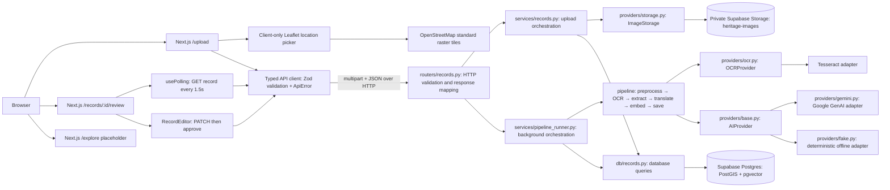

# Heritage Atlas — current architecture

The repository contains a Next.js App Router frontend and the FastAPI upload/review backend. The implemented product surfaces are Upload, asynchronous processing and Review. Explore is a deliberate placeholder in this frontend part: there is no Explore map or semantic-search screen yet. The uploaded image stays in private Supabase Storage; Review shows the team's approved placeholder rather than exposing an object URL.

## Layers and request flow



HTTP routes validate and map requests/responses only. Services own business orchestration; pipeline modules own individual transformations; OCR, AI and storage external calls sit behind replaceable interfaces; SQL queries remain in `db/`. This keeps providers swappable and allows the pipeline to be exercised offline. The rejected alternative was placing database/storage/AI logic directly in route handlers, which would make HTTP and business logic harder to test independently.

### Frontend boundaries and decisions

`frontend/src/lib/api.ts` owns browser-to-API requests, and `frontend/src/types/api.ts` parses request/response shapes with Zod to match the backend Pydantic schemas. Components do not call `fetch` directly; scattered fetch calls and unchecked response casts were rejected because schema drift should become a typed, friendly error instead of a runtime crash.

The review screen polls with a cleanup-safe recursive timeout and aborts the active request when unmounted. A recursive timeout was chosen over `setInterval` so slow calls cannot overlap or queue; polling stops at `needs_review`, `failed` or `approved` and can restart after retry.

The Upload map is dynamically imported with `ssr: false` inside a Client Component because Leaflet needs browser layout APIs. It uses OpenStreetMap's free standard tiles with attribution; server-rendering the Leaflet map and requiring a paid map-provider key were rejected. Follow the [OSM tile usage policy](https://operations.osmfoundation.org/policies/tiles/) and do not generate bulk tile traffic.

The Review page's image area is explicitly a labelled placeholder while the bucket remains private. Making the bucket public was rejected to protect uploaded sources; a signed-URL API is also intentionally not added in this phase, per the team's choice.

Tailwind v3 keeps the requested color/font tokens in `frontend/tailwind.config.js`. The CSS-first v4 approach was rejected because the team asked for the palette in a Tailwind config file. The exact user-specified brand colors are retained; accessible text uses deep ink/indigo and a darker terracotta text token. Checked foreground/background combinations exceed 4.5:1 contrast.

Explore is a real navigation destination with a plain next-phase message, not an unimplemented map or search mock. Building semantic search now was rejected because the current phase explicitly excludes it; this keeps the application at the requested screens and avoids implying unsupported functionality.

## Pipeline stages

Each stage receives `PipelineContext` and reports expected failures through `PipelineError`. The runner records `processing` and the current stage before execution, persists successful checkpoints, logs stage timing, and moves failures to `failed` with a readable message. The last stage moves a record to `needs_review`; the pipeline never auto-approves. `POST /records/{id}/retry` accepts failed records and resumes at the persisted failed stage.

| Stage | Input | Output | Failure mode | What the user sees |
|---|---|---|---|---|
| preprocess | Original image bytes | Resized (max 2000 px), grayscale, denoised, thresholded/deskewed image; original bytes retained | Invalid/decode or OpenCV error → failed at `preprocess` | Record status `failed`, readable error |
| ocr | Processed image | OCR text and mean word confidence from `eng+hin+guj`; fewer than 20 chars is non-fatal | Tesseract/data error → failed at `ocr`; little/no text continues | Poll status; OCR fields are saved as a checkpoint |
| extract | OCR text, place name, original image | Pydantic-validated heritage fields | Provider failure → failed at `extract`; invalid output is corrected once then degraded with warning | Reviewable record; low-confidence fallback carries a warning |
| translate | OCR text and detected language | English text (copy if already English) | Provider failure → failed at `translate` | Poll status and see error; earlier OCR/extraction remain saved |
| embed | Truncated search document, at most 2000 chars | Exactly 768 floats | Provider/dimension error → failed at `embed` | Poll status and retry from `embed` |
| save | Completed context | Record fields, vector, warning, status `needs_review` | Database failure → failed at `save` | Record is ready for human review when successful |

## Configure and run

The container installs Tesseract plus English, Hindi and Gujarati data packages. On local Linux, install those system packages if Tesseract is not already present. Python setup from the repository root:

```bash
python3 -m pip install -r requirements.txt
cp .env.example .env
# Fill Supabase URL/service key; Gemini is optional if AI_PROVIDER=fake.
uvicorn app.main:app --reload --app-dir backend
```

The backend environment template reads model identifiers from environment variables. The configured no-charge Gemini options and SDK usage were verified against the [official Google model/pricing notes](model-verification.md); availability, free-tier terms and quotas can change, so re-check before the demo. Keep the no-paid-API requirement absolute by choosing the offline fake AI provider, while remembering that records and image storage still require Supabase.

From `frontend/`, copy the non-secret example to `.env.local`, set `NEXT_PUBLIC_API_URL=http://127.0.0.1:8000`, and run:

```bash
pnpm install --frozen-lockfile
npm run dev
```

Open `http://localhost:3000/upload`. For browser requests from a different preview origin, include that exact origin in backend `CORS_ORIGINS`; never place the Supabase service key or Gemini API key in `NEXT_PUBLIC_*` variables. Frontend checks from the same directory:

```bash
npm run lint
npm run typecheck
npm run build
```

Open `http://127.0.0.1:8000/docs` to inspect the backend endpoints. Run backend tests from the repository root with:

```bash
PYTHONPATH=backend python3 -m pytest -q backend/tests
```

To exercise real image persistence and processing, apply `supabase/migrations/001_init.sql`, create the `heritage-images` bucket as private in Supabase Dashboard, and configure the backend environment. Upload a scanned image, then poll `GET /records/{id}`; successful processing ends in `needs_review`. With `AI_PROVIDER=fake`, AI calls are deterministic and offline, but a configured Supabase database and Storage bucket are still needed. To exercise failure/retry, wait for `failed`, correct the provider issue and call `POST /records/{id}/retry`.

## Known constraints

- Background work is process-local. If the API stops, a running task may not finish; replace it with a durable queue only if delivery guarantees become a requirement.
- Free Gemini quotas and model availability are account-dependent. The fake provider avoids model calls for demos, but its translation is identity and its embeddings are deterministic hashes, not semantic vectors.
- The API's private Storage image has no browser retrieval endpoint in this phase; the review page intentionally shows an explanation instead of an image or zoom control.
- The full browser upload-to-approval flow requires Supabase migration/bucket setup and backend credentials. Without those external services configured, the frontend can be built and its screens inspected, but real record creation/processing cannot succeed.
- Storage upload precedes database insertion, so a failed insert can leave an orphan image. Uploads are checked for supported MIME type and size, but bytes are not signature-sniffed.


## Approval-field interpretation

The review form keeps title, type and other extracted metadata editable, but it does not invent non-empty approval requirements: this phase names those fields without specifying which must be mandatory, and the current backend schema permits nulls. Consequently, the current API can approve a record with sparse metadata; if the team wants a required-field policy, ask before adding it to both frontend and backend.
